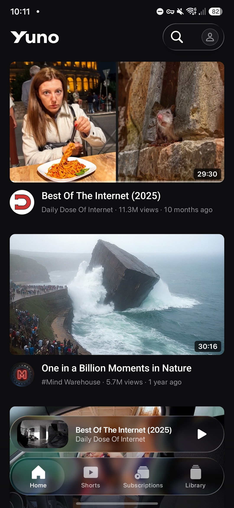
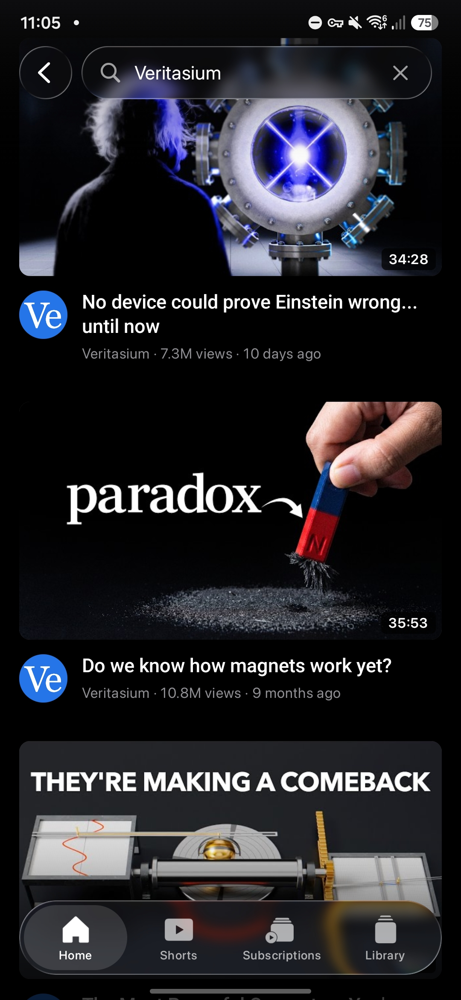
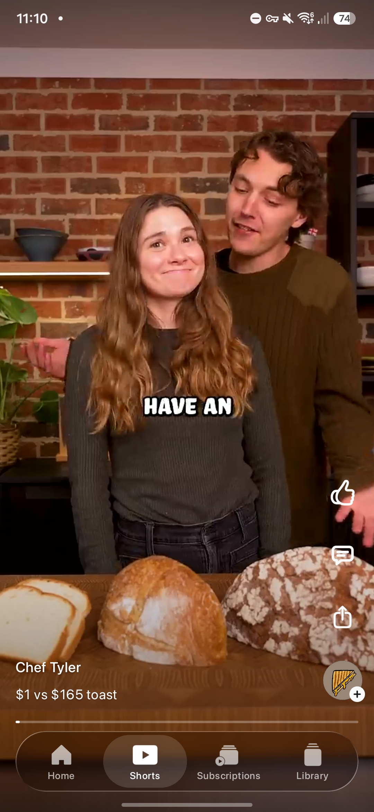

<div align="center">

<br/>
<br/>


<hr />

### An ad-free YouTube player for Android

<br/>

[](https://github.com/danielkanan/Yuno/releases)
[](https://github.com/danielkanan/Yuno/blob/main/LICENSE)
[](https://github.com/danielkanan/Yuno/releases)

<br/>

[**Download**](#download) · [**Features**](#features) · [**Building**](#building) · [**Disclaimer**](#disclaimer)

<br/>

</div>

> [!IMPORTANT]
> Yuno is not affiliated with, endorsed by, or connected to YouTube or Google in any way. Use it at your own discretion.

---

<div align="center">

<table width="100%">
  <tr>
    <td width="33%"></td>
    <td width="33%"></td>
    <td width="33%"></td>
  </tr>
</table>

<h1><a id="features"></a>Features</h1>

<table>
  <tr>
    <td width="50%" valign="top">

#### Playback
- **Search and play** YouTube with no sign-in required.
- **Up to 1080p** — video and audio as separate streams, merged through generated DASH manifests (avoids YouTube throttling).
- **Player controls on the video:** ±10 s skip, draggable scrubber, chapters and SponsorBlock marks, quality and captions; controls auto-hide after 2 s.
- **Mini-player morph** — swipe the player down to minimize (it follows your finger) or swipe the mini-player up to expand; live video in the mini-player.
- **Background audio** with a media notification.
- **Queue** — long-press any video for Play next / Add to queue.
- **Playback speed** (0.5×–3×, optional “remember for every video”) and **audio-only** mode.
- **SponsorBlock** — per category Skip / Ask / Show / Off, with audio-fade skips and Undo.

#### Player bar
- While a video is open, the tab bar becomes the **player bar** (−10 · play · +10 · tools): quality, PiP, fullscreen, speed, chapters, and scrub with storyboard preview.

    </td>
    <td width="50%" valign="top">

#### Shorts & feeds
- **Shorts tab** — vertical feed (personalized when signed in). Frosted-glass bar with Like, Comments, Share, and channel subscribe.
- **Shorts bank** — the next 10 unseen shorts are cached on disk (~100–150 MB) so they start instantly; seen shorts are forgotten and refilled in the background.
- **Home & Subscriptions** when signed in; **Library** for history, playlists, Watch later, and liked videos.

#### Account & community
- **Optional Google sign-in** — full sync: recommendations, subscriptions, history, likes, subscribes, Save, Watch later, watch history, and **comment/reply posting**.
- Session cookies stored **AES-GCM encrypted** (Android Keystore).
- **Comments** with avatars, replies, and likes (signed in).
- **Self-update** from GitHub releases when a newer APK is published.

    </td>
  </tr>
</table>

</div>

---

<div align="center">

<h1><a id="download"></a>Download</h1>

**[Yuno.apk](https://github.com/danielkanan/Yuno/releases/latest/download/Yuno.apk)** — latest release. Open it on your phone and allow installs from your browser; updates install over the previous build.

Publishing: bump `versionName` / `versionCode` in `app/build.gradle.kts`, then run `scripts/publish-apk.sh`.

</div>

---

<div align="center">

<h1><a id="building"></a>Building</h1>

Android SDK (compileSdk 36) and JDK 17+. Android Studio’s bundled JDK works:

```sh
export JAVA_HOME="/Applications/Android Studio.app/Contents/jbr/Contents/Home"
./gradlew assembleDebug      # app/build/outputs/apk/debug/app-debug.apk
./gradlew assembleRelease    # R8-shrunk, debug-signed — judge feel on this build
./gradlew testDebugUnitTest  # InnerTube / parser tests
```

Key paths: `app/src/main/java/com/yuno/` (player, feeds, Shorts, service). Product notes for contributors: [`CLAUDE.md`](CLAUDE.md).

</div>

---

<div align="center">

<h1><a id="disclaimer"></a>Disclaimer</h1>

Yuno is an independent, sideloaded **YouTube player**. It is **not** associated with Google LLC, YouTube, or any of their services. It is not distributed through the Play Store.

* **No hosting:** Yuno does not host videos; it plays streams from YouTube via [NewPipeExtractor](https://github.com/TeamNewPipe/NewPipeExtractor).
* **Your responsibility:** Use aligns with YouTube’s Terms of Service and your local laws. Google may suspend accounts used with unofficial clients.
* **SponsorBlock** data is CC BY-NC-SA 4.0 ([SponsorBlock](https://sponsor.ajay.app)); non-commercial use only.
* **Copyleft:** GPL-3.0 (required by NewPipeExtractor). See [LICENSE](LICENSE).

</div>

---

<div align="center">

<h1><a id="license"></a>License</h1>

This project is licensed under the **GNU General Public License v3.0 (GPLv3)**. See [LICENSE](LICENSE).

</div>
